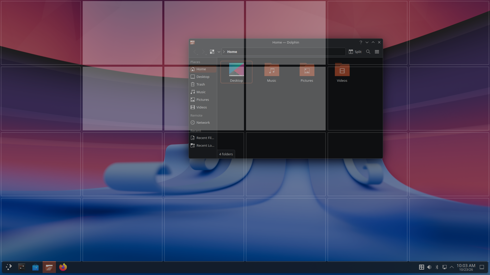
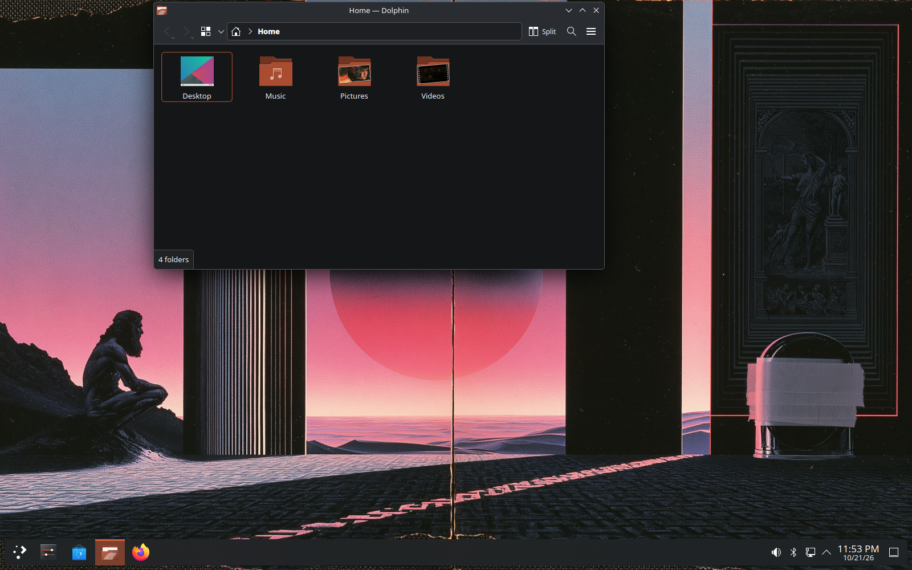
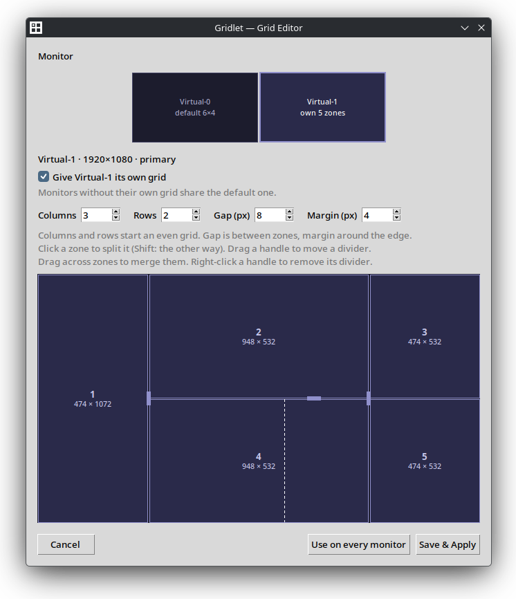

# Gridlet

A FancyZones-style window grid for KDE Plasma: hold Ctrl+Meta while dragging a window, paint a zone, and it snaps there.



Drag a window, hold **Ctrl+Meta**, and a grid appears over the screen. Move
across the cells to paint a zone, release the mouse, and the window snaps to
fill it. I built it because I wanted PowerToys FancyZones' drag-to-zone
snapping on KDE Plasma. It started on X11; Wayland forbids apps from reading
global modifiers or moving other apps' windows, so the Wayland version moved
the engine inside the compositor as a KWin script, with a small helper reading
the held modifier from the kernel input device.

## Features

- Hold Ctrl+Meta while dragging any window to bring up the grid; paint a zone across cells; release to snap
- Release Ctrl+Meta first to cancel, with a short grace period for a slightly late mouse release
- Snaps within the work area, so panels stay clear; with several monitors it uses the one under the cursor
- A Grid Editor for rows, columns, gap and margin, applied live
- A tray icon to enable, disable or quit, reachable even if the overlay misbehaves
- Installs per user, starts on login, and uninstalls cleanly

## Status

The Wayland version is the current one, tested on SteamOS (KWin 6.4) and
Fedora 44 (Plasma 6.7); the [X11 version](x11/) is the original and stays as
the reference for behaviour. Missing: mixed per-monitor scale factors are
untested, the hotkey is set in `config.json` rather than in the editor, and
KWin's Scale effect animates the overlay unless you turn it off (see
[`wayland/README.md`](wayland/README.md#known-limitations--todo)).

## Built with

| Piece | What it does | Built with |
|---|---|---|
| KWin script ([`wayland/kwin-script/`](wayland/kwin-script/)) | The overlay and snapping engine, running inside KWin | QML and JavaScript, KWin 6 scripting |
| Keyboard helper | Watches the keyboard for Ctrl+Meta and tells the script through kglobalaccel | Python standard library |
| Tray | Enable, disable, quit | dbus-python (StatusNotifierItem) |
| Grid Editor | Rows, columns, gap and margin | Python, tkinter |
| [`x11/`](x11/) | The original X11 app | Python, python-xlib, pycairo, pystray, Pillow |

The Wayland pieces need KDE Plasma 6 in a Wayland session and Python 3 with
`dbus-python`, PyGObject and tkinter. How they fit together, the configuration
format, the development loop and the KWin constraints the design works around
are in [`wayland/README.md`](wayland/README.md).

## Build and run

There is nothing to compile. On Fedora, once per machine (SteamOS needs none
of this), give Gridlet read access to the keyboard and make sure tkinter is
present, then **reboot**, which is what reliably applies the keyboard
permission. Without it, Ctrl+Meta silently does nothing; what the rule grants,
and why, is explained in [`wayland/README.md`](wayland/README.md#prerequisites-off-steamos-eg-fedora).

```bash
git clone https://github.com/jacksonvw/gridlet.git
cd gridlet
sudo cp wayland/70-gridlet-input.rules /etc/udev/rules.d/
sudo dnf install python3-tkinter      # usually already installed; harmless if so
```

Then, after that reboot:

```bash
bash wayland/install.sh     # install, enable and start; it also starts on login
bash wayland/uninstall.sh   # remove everything
```

Drag a window and hold **Ctrl+Meta**. The **Gridlet** tray icon enables,
disables or quits it, and **Gridlet Grid Editor** in the app menu edits the
grid.

The X11 original runs on its own with `python3 x11/main.py`; its requirements
are in [`x11/README.md`](x11/README.md).

## More screenshots





---

Jackson Vander Wal · [jacksonv.com](https://jacksonv.com)
